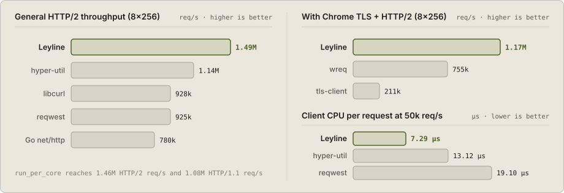

# leyline-http

[](https://crates.io/crates/leyline-http)
[](https://docs.rs/leyline-http)
[](https://github.com/manaforged/leyline-http/actions/workflows/ci.yml)
[](https://github.com/manaforged/leyline-http/blob/main/LICENSE)

Leyline is a fast async HTTP/1.1, HTTP/2, and HTTP/3 client for Rust. Sessions, cookies, proxies, crawling, resumable downloads, and browser TLS profiles all come built in.

- HTTP/1.1, HTTP/2, and HTTP/3 over BoringSSL, with a thread-per-core mode (`run_per_core`)
- Sessions with shared connections, cookies, caching, and optional blocking use
- Encrypted DNS (RFC 8484 DoH) and TLS 1.3 Encrypted Client Hello (ECH) with automatic retry recovery
- mTLS (PEM and PKCS#12), certificate pinning, Unix domain sockets, interface and local-IP binding, and rotating HTTP/HTTPS/SOCKS5 proxy pools with custom proxy headers
- Browser tabs that track referers, links, and HTML forms
- Site crawling with `robots.txt`, sitemaps, rate limits, and checkpoints
- Retries, timeouts, redirects, resumable downloads, server-sent events (SSE), and WebSocket
- Optional TLS (JA3/JA4), HTTP/2, HTTP/3, and TCP (JA4T) profiles for Chrome, Firefox, Safari, Edge, Opera, and Brave

## Example

```toml
[dependencies]
leyline-http = "0.2"
tokio = { version = "1", features = ["macros", "rt-multi-thread"] }
```

```rust,no_run
use std::time::Duration;

use leyline::{Browser, Session};

#[tokio::main]
async fn main() -> leyline::Result<()> {
    let session = Session::builder()
        .browser(Browser::Chrome154)
        .timeout(Duration::from_secs(15))
        .retry(2)
        .build()?;

    let body = session.get("https://example.com/").text().await?;
    println!("{body}");
    Ok(())
}
```

Rust 1.96 or later. Leyline supports every stable Rust released in the last six months; a minor release may raise the minimum to drop older ones. Building BoringSSL needs a C and C++ compiler and `git`.

To crawl a site while respecting `robots.txt` and per-host rate limits:

```rust,no_run
use leyline::Session;

# async fn run() -> leyline::Result<()> {
let mut crawl = Session::new().crawl("https://example.com/").limit(100);
while let Some(page) = crawl.next().await {
    let page = page?;
    println!("{} ({} bytes)", page.url(), page.text().len());
}
# Ok(())
# }
```

## Performance

HTTP/2 requests per second against a local origin on a Ryzen 9 9950X3D, with
identical request headers and verified TLS. Medians of three runs; higher is
better.

<p align="center">
  <picture>
    <source media="(prefers-color-scheme: dark)" srcset="docs/assets/bench-dark.svg">
    <source media="(prefers-color-scheme: light)" srcset="docs/assets/bench-light.svg">
    
  </picture>
</p>

| Client | Sequential | 8 connections, 256 in flight |
| --- | ---: | ---: |
| **Leyline** | **57,985** | **1,430,815** |
| hyper-util | 45,010 | 1,120,042 |
| reqwest | 36,318 | 898,811 |
| libcurl | 46,682 | 786,210 |
| Go net/http | 41,835 | 619,826 |

Leyline also uses less client CPU per request than each of them in all four
measured HTTP/2 workloads (and fewer user-space instructions per request than
the bare `h2` crate). At a fixed offered rate of 50,000 HTTP/2 requests per
second, its p99 latency is 120 µs at 8.18 µs client CPU/req, against 134 µs
(12.29 µs CPU) for libcurl, 154 µs (13.82 µs CPU) for hyper-util, and 159 µs
(19.92 µs CPU) for reqwest. [BENCHMARKS.md](BENCHMARKS.md) has every workload,
HTTP/1.1, confidence intervals, and the commands to reproduce them.

For the highest request rate, `SessionBuilder::run_per_core` runs one runtime
per CPU core; the cores share cookies, cache and tokens and keep their own
connections. In that layout Leyline reaches 912k HTTP/1.1 req/s in the long
64-worker runs (ahead of fasthttp at 8 workers and tied at 64, at 0.79–0.83×
CPU) and leads the bare `h2` crate at 8 and 256 requests in flight over eight
HTTP/2 connections.

## Browser profiles

A browser profile sends the TLS ClientHello, HTTP/2 and HTTP/3 settings, and
header order of a real browser build, taken from captures of that browser:

```rust,no_run
use leyline::{Browser, Session};

# async fn run() -> leyline::Result<()> {
let session = Session::builder().browser(Browser::Chrome154).build()?;
# drop(session);
# Ok(())
# }
```

Profiles send larger headers, so they cost 4% to 21% of throughput. With
profiles on, Leyline handles 1.57 times the requests per second of wreq and 5.92
times those of tls-client at 256 in flight, using 0.38× and 0.11× their client
CPU per request.

## Documentation

- [User guide](https://manaforged.github.io/leyline-http/): task-by-task guides for sessions, TLS, proxies, crawling, and throughput
- [API reference](https://docs.rs/leyline-http): rustdoc for every public type and method
- [For coding agents](AGENTS.md): concise patterns and type map for coding agents
- [Upgrade guide](UPGRADE.md): 1-to-1 migration tables for breaking changes
- [Changelog](CHANGELOG.md): release notes, breaking changes, and benchmark highlights
- [Qualification](QUALIFICATION.md): what is proved, tested, and measured under failure and load

Before `1.0`, breaking changes are limited to clear correctness or ergonomic fixes, and every one is mapped in [UPGRADE.md](UPGRADE.md).

## License

[MIT](LICENSE). The BoringSSL and quiche forks keep their own licenses; see [NOTICE](NOTICE).
